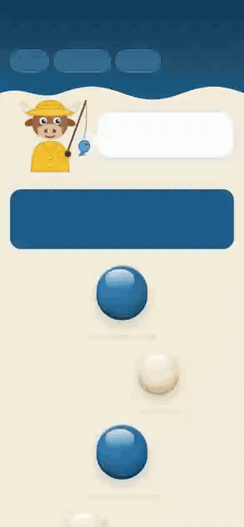
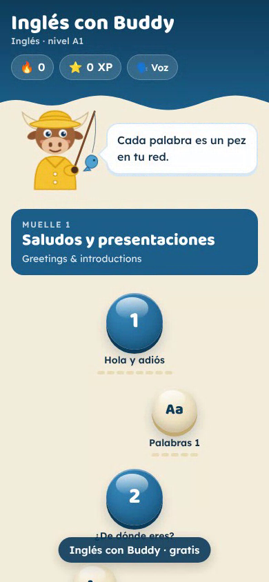
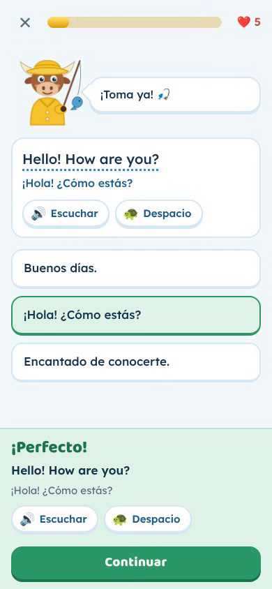
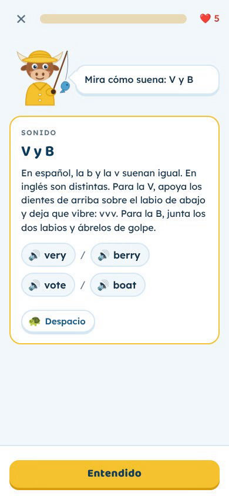

# 🎣 Inglés con Buddy

**A free app for learning A1-level English, built for Spanish-speaking friends.**

👉 **Play here:** https://sylvievvv.github.io/ingles-con-buddy/

  

<a href="https://sylvievvv.github.io/ingles-con-buddy/media/demo.mp4">▶️ Watch the demo as a video (mp4)</a>

---

## The story

A few of my Spanish friends wanted to learn English. They tried apps like Duolingo but found the paid subscriptions too expensive. Their biggest struggle was also **pronunciation**: many English sounds don't exist in Spanish, or sound the same there, and most apps barely cover that.

So I built them an app of my own: **free, no ads, no account**, and focused on the things Spanish speakers find hard about English.

## Problem and solution

| Problem | How the app solves it |
|---|---|
| Language app subscriptions are expensive | Completely free. It's a single web page that works on any phone, with nothing to install and no account. |
| Beginners don't know English yet, so explanations in English don't help | All explanations, buttons and tips are in **Spanish**. |
| In Spanish, V and B sound the same, and the H is silent | A dedicated topic, **"Sonidos del inglés"**, with listening exercises (minimal pairs). |
| You can't hear the difference when you don't know the language yet | Listen to both words separately first, with the key letters highlighted and a hint about mouth position (*"dientes sobre el labio"*). |
| Spoken English is too fast | Every sentence has a 🔊 button and a 🐢 button to hear it slowly. |
| Getting things wrong is discouraging | Buddy stays positive. A wrong answer gets a short tip, and the question comes back later. |

## What's inside

- **Buddy**, a cheerful bull in a fisherman's hat with a fishing rod. He jumps for joy at a right answer and shakes his head at a wrong one.
- **6 A1 topics**: greetings, numbers and time, family, food and drink, daily routine, and the city and asking for directions. Each topic has 3 chapters of 8 questions.
- **Pronunciation**: V/B, the final L, TH, H, short and long vowels, S at the start of a word (no "eschool"), SH/CH, J/Y and final consonants.
- **Question types**: multiple choice, typing, building sentences from word tiles, listening, and word matching.
- **Word exercises** where new words come in and earlier words come back for review.
- Tap an English sentence to see the Spanish translation.
- 5 lives per lesson, XP, a daily streak 🔥 and progress dashes under each chapter.
- Pick your own English voice (🗣️ Voz).
- Every chapter is open from the start, with nothing to unlock.

  
  
  

## How it works

- One file: [`index.html`](index.html), with HTML, CSS and JavaScript. No framework and no server.
- **Voice**: the browser's built-in speech (Web Speech API), so the voice you hear depends on your phone. On an iPhone, the "Premium" or "Enhanced" voices sound the most natural.
- **Progress** is saved in the browser (`localStorage`) on the device itself. Nothing is sent anywhere.
- Hosted with **GitHub Pages**.

## Para jugar 🇪🇸

1. Abre **https://sylvievvv.github.io/ingles-con-buddy/** en Safari o Chrome.
2. En el iPhone: pulsa *Compartir* → *Añadir a pantalla de inicio* para tenerlo como una app.
3. Sube el volumen: pulsa 🔊 para escuchar y 🐢 para escuchar despacio.
4. ¡Un poquito cada día! 🎣

---

Made with ❤️ for my Spanish friends.
